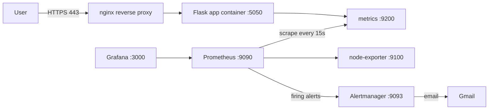

```markdown
# 💸 Expense Tracker — a full DevOps lifecycle project

One realistic small-business app, taken through manual deploy → Docker →
CI/CD → Terraform → HTTPS → monitoring. Live: https://app.thehimma.com/health

## The stack



| Layer | Technology |
|---|---|
| App | Python 3.12, Flask, SQLite |
| Container | Docker, Docker Compose (5 services) |
| CI/CD | GitHub Actions — test → build → deploy with human approval gate |
| Infra | AWS EC2 (eu-west-2), written in Terraform |
| Security | least-privilege IAM, Secrets Manager, Trivy scans |
| Monitoring | Prometheus, Grafana, Alertmanager → Gmail alerts |

## Operations manual

- [Deploying and rolling back](docs/runbooks/deploy.md)
- [What to do when AppDown fires](docs/runbooks/app-down.md)
- [Backing up and restoring the database](docs/runbooks/restore.md)
- [Cold start after a reboot](docs/runbooks/reboot.md)
- [What this costs to run](docs/cost-report.md)

## Known limits (honest section)

Monitoring lives on the same server as the app — if the box dies, the
dashboards die with it. An external heartbeat is on the roadmap.
```
